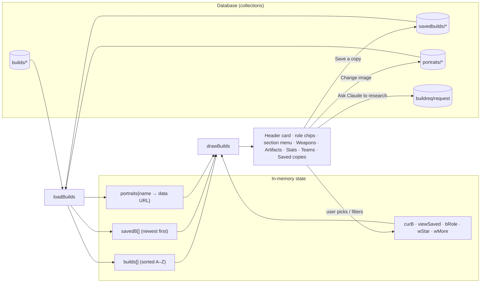
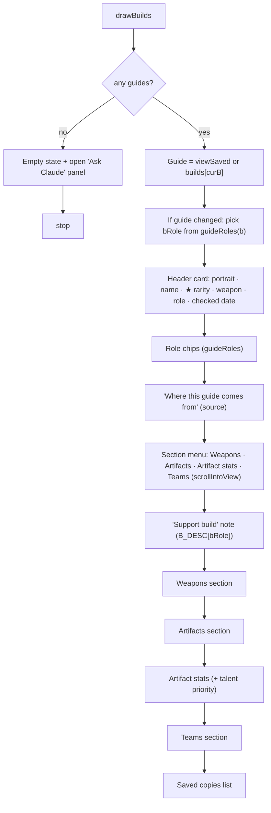
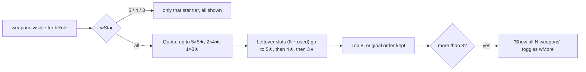
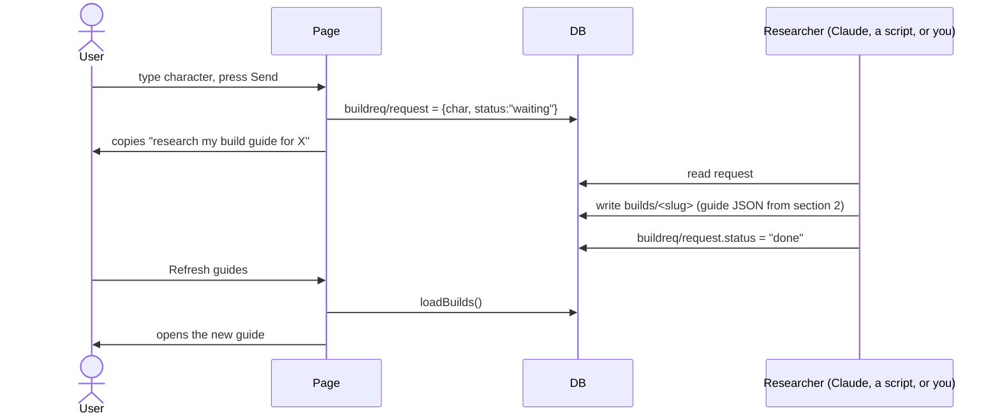

# Build Guides: logic map

How the Build Guides view in Genshin Studio works, written so you can rebuild
it in another project. Code references point at `genshin-dashboard/index.html`
(search for the function names).

---

## 1. The big picture



The whole view is **one render function** (`drawBuilds`) that clears the
container and redraws everything from state. Every user action changes a
state variable and calls `drawBuilds()` again. No partial updates.

---

## 2. Data shape (one guide)

```jsonc
{
  "name": "Mika",
  "info": { "rarity": 4, "weapon": "Polearm", "role": "Healer & Physical support", "element": "cryo" },
  "source": "Icy Veins Mika build guide …",   // shown under "Where this guide comes from"
  "checkedAt": 1792000000000,                  // ms timestamp → "Checked 11/14/2026"
  "popularRole": "support",                    // optional: which role chip comes first
  "roleLabels": { "dps": "Physical DPS" },     // optional: rename a role chip
  "weapons":   [{ "name": "…", "stars": 5, "why": "…", "roles": ["support"] }],
  "artifacts": [{ "name": "…", "type": "4pc" | "2pc", "why": "…", "roles": ["dps"] }],
  "stats":     { "sands": "…", "goblet": "…", "circlet": "…", "substats": "…" },
  "statsBy":   { "dps": { "sands": "…", … } },  // optional per-role override of stats
  "talents":   [{ "name": "…", "level": "10", "why": "…" }],
  "teams":     [{ "name": "…", "members": ["A","B","C","D"], "note": "…", "popular": true, "roles": ["support"] }]
}
```

Every list item can carry `roles`. An item **without** `roles` shows for every role.

A **saved copy** is the same object plus `savedAt` (ms) and `baseId` (the guide it was copied from), stored under `savedbuilds/<name-slug>-<savedAt>`.

---

## 3. State

| Variable | Meaning | Reset when |
| --- | --- | --- |
| `builds[]` | All guides, sorted by name | `loadBuilds()` |
| `curB` | Index of the open guide | Pick another guide (kept by **name** across reloads) |
| `viewSaved` | A saved copy being viewed instead of the live guide, or `null` | Picking any guide |
| `bRole` | Active role filter: `support` · `subdps` · `hybrid` · `dps` | Guide changes and the old role isn't offered |
| `wStar` | Weapon star filter: `all` · `5` · `4` · `3` | Guide changes |
| `wMore` | Show all weapons instead of the top 8 | Guide or star filter changes |
| `portraits{}` | Lower-cased name → image data URL | `loadBuilds()` |

The guide on screen is always `viewSaved || builds[curB]`.

---

## 4. Loading

```mermaid
sequenceDiagram
  participant Page
  participant DB
  Page->>DB: get builds/*
  DB-->>Page: docs → sort by name
  Page->>DB: get savedbuilds/*
  DB-->>Page: docs → sort by savedAt desc
  Page->>DB: get portraits/*
  DB-->>Page: keep only {name, img:"data:image/…"}
  Note over Page: keep the same guide open by matching its name
  Page->>Page: drawBuilds()
  DB--)Page: onSnapshot(builds) changes
  Note over Page: wait 600 ms; if the user is typing in Build Guides, retry in 3 s
  Page->>Page: loadBuilds(); if a new guide appeared, open it
```

Each collection read is wrapped in its own `try/catch` and falls back to an empty list, so one failing collection never blanks the page.

---

## 5. Render order (`drawBuilds`)



---

## 6. The rules

### 6a. Role filter

```text
ROLES = support, subdps, hybrid, dps          (display order)

rolesOf(item):
  r = item.roles
  if r has support AND dps and not hybrid → add hybrid
  return r in ROLES order

guideRoles(guide):
  set = union of rolesOf(x) for x in weapons + artifacts + teams
  if set is empty → guess from info.role text:
     /support|healer|buffer/ → support, /hybrid/ → hybrid, /dps|carry|damage/ → dps
  list = ROLES filtered by set
  if guide.popularRole in list → move it to the front
  return list

inRole(item, role):
  true if item has no roles
  true if role in item.roles
  true if role == hybrid and item has both support and dps

visible(item) = inRole(item, bRole)
```

When the guide changes, if `bRole` isn't in `guideRoles(guide)` it becomes the first one.
Stats use `statsBy[bRole]` when it exists, otherwise `stats`.

### 6b. Weapons: top 8 with a star mix



Star chips only appear for tiers that have weapons: `All (10)`, `5★ (1)`, `4★ (9)`.

### 6c. Artifacts
Visible for `bRole`, **4-piece sets first**, then 2-piece, original order otherwise.

### 6d. Teams
Visible for `bRole`, `popular: true` first, then original order. The first team gets a **Most popular** pill.
Members show max 4, with the guide's own character moved to the front (`bFirst`: name matches exactly or as a prefix word, e.g. "Mika" ↔ "Mika (C6)").

### 6e. Element colour and icon
`elOf(guide)` returns the first known element from: `info.element` → the characters dataset → a fixed name → element table → a word in `info.role`. The element sets the card's accent colour and the badge icon on the portrait.

### 6f. Portrait
1. Uploaded portrait for this name (`portraits[name]`)
2. else a saved character card face
3. else the first letter of the name

A rarity background (`portraits.__bg4` / `__bg5`) sits behind it when present.

---

## 7. Actions

| User does | Code | Effect |
| --- | --- | --- |
| Types/picks a guide | `suggest(#b-find …)` | `curB = i; viewSaved = null; drawBuilds()` |
| Clicks a role chip | `drawRoles` | `bRole = k; drawBuilds()` |
| Clicks a star chip | weapons section | `wStar = k; wMore = false; drawBuilds()` |
| Show all weapons | weapons section | `wMore = !wMore; drawBuilds()` |
| Section menu button | `.bjump` | `section.scrollIntoView()` |
| **Copy as text** | `#b-copy` → `buildText(b)` | Plain-text guide to clipboard; button says "Copied" for 1.8 s |
| **Save a copy** | `#b-save` | Deep-copies the guide, adds `savedAt` + `baseId`, writes `savedbuilds/<slug>-<time>` |
| Open saved copy | `drawSaved` | `viewSaved = copy; drawBuilds()` (frozen snapshot, unaffected by updates) |
| Delete saved copy | `drawSaved` | Deletes the doc; if it was open, `viewSaved = null` |
| Change / Remove image | `charCard` | Reads file → data URL → `portraits/<slug>` doc |
| Ask Claude to research | `#b-send` | Writes `buildreq/request = {char, status:"waiting", at}` and copies "research my build guide for X" |
| Refresh guides | `#b-refresh` | `loadBuilds()`, then opens: the typed name → else a brand-new guide → else the request's `char` once `status:"done"` |

### Copy-as-text format (`buildText`)

```text
<Name> build guide (<source>)

WEAPONS
1. <name> ★★★★★ - <why>
ARTIFACTS
1. <name> (4pc) - <why>
ARTIFACT STATS
Sands: … / Goblet: … / Circlet: … / Substats: …
TALENT PRIORITY
1. <name> - level <n> - <why>
TEAMS
<team name>: A / B / C / D - <note>
```

---

## 8. The research request loop



The page never researches anything itself. Any process that writes a guide in
the section 2 shape into `builds/` makes it appear.

---

## 9. Porting checklist

- [ ] A key-value store with `collection(path).get()`, `doc(path).get/set/delete`, and optionally `onSnapshot` (Firestore works as-is; `runtime.js` shows a localStorage version).
- [ ] Guides in the section 2 shape under `builds/<slug>`.
- [ ] One `render()` that redraws from state; every action = change state + `render()`.
- [ ] Rules from section 6: role filter, top-8 weapon mix, 4pc-first artifacts, popular-first teams.
- [ ] Optional: saved copies, portraits, and the research request loop.
- [ ] Rename the domain words (weapons, artifacts, element) for your project; the structure is generic: *item → ranked lists filtered by role, with a copyable text export*.
